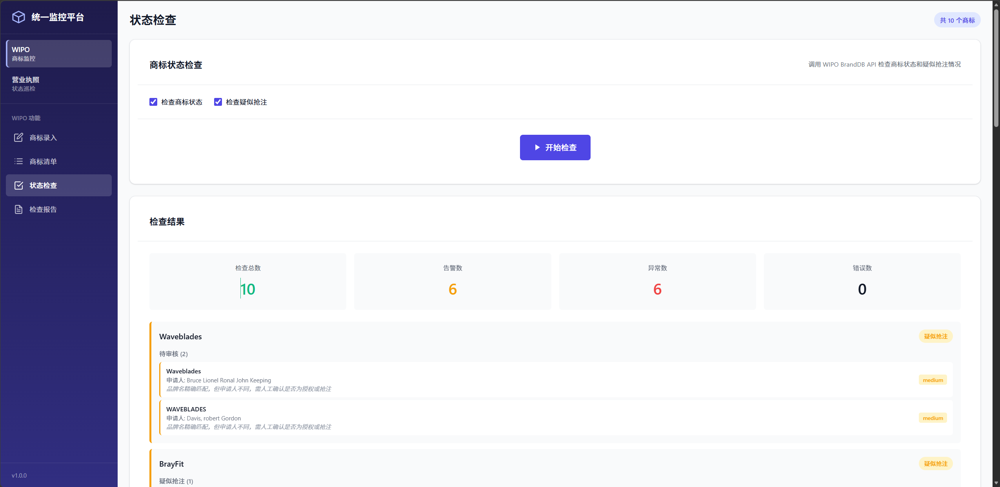
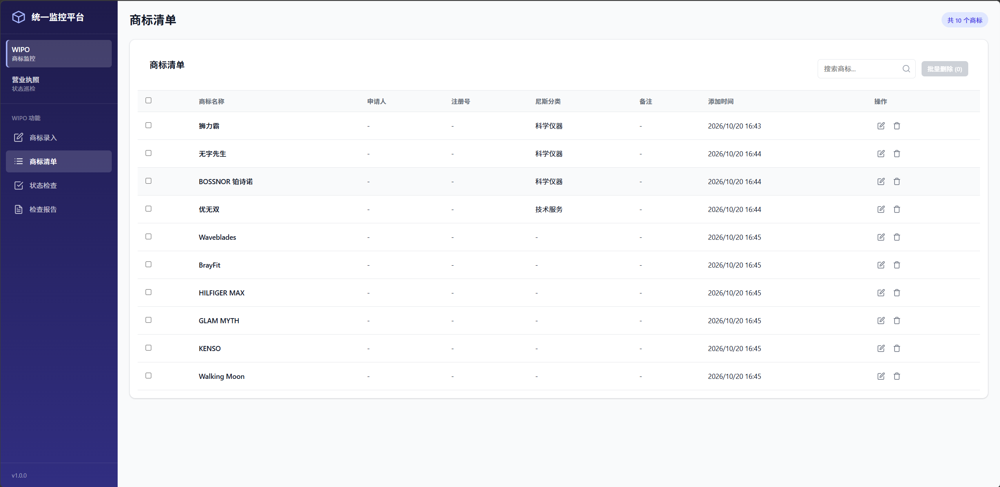
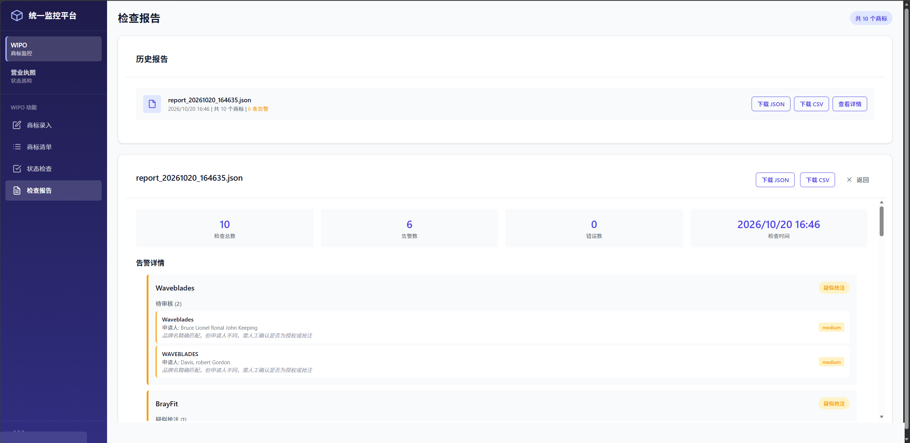
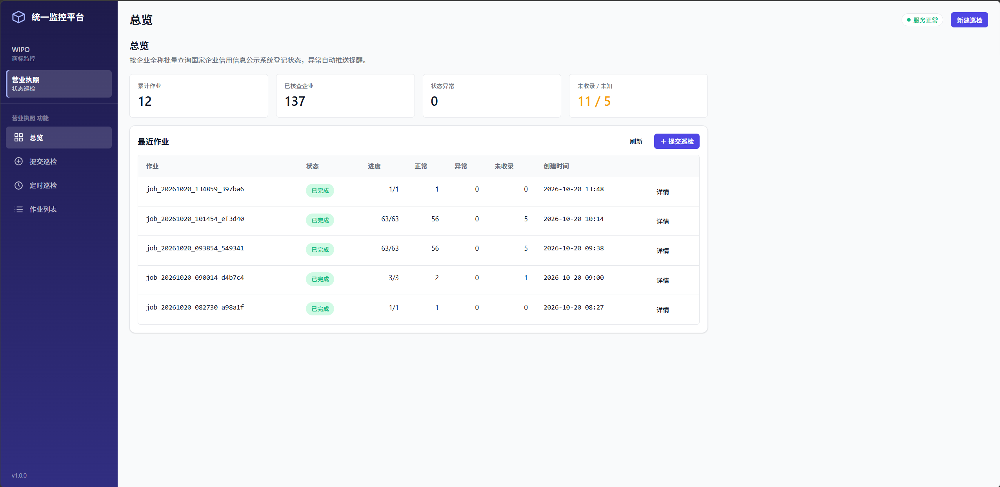
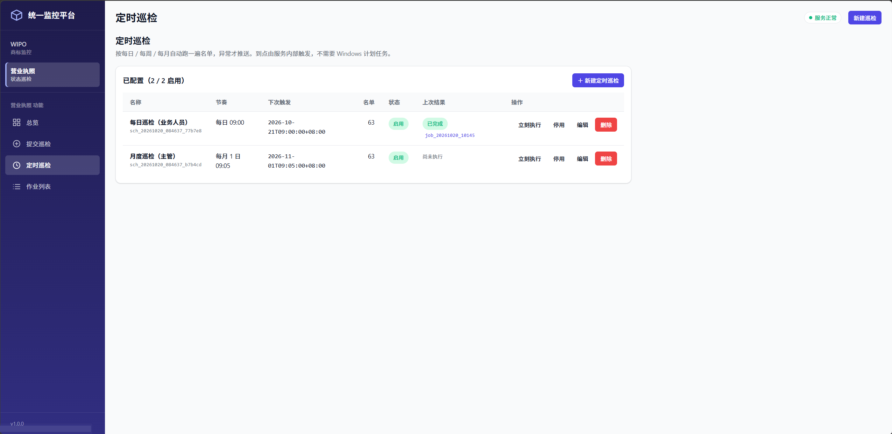

# 聚统 · Aggregated Query & Inspection System（公开演示版）

> 把两个原本独立部署的系统合成**一个服务入口**：一份 OpenAPI、一个进程、两个功能模块。
> 前端是**一套统一的 SPA**（左侧系统列表切换两个子系统），不再是两个各跑各的界面。

**⚠️ 公开演示版声明**：本仓库是项目的**演示/教学版**。以下内容**未包含**在本仓库中，属于私有部分：
企业级部署配置与生产环境参数、真实巡检企业名单、品牌方数据与商标监控样本、
告警接收人配置、以及部分针对特定站点验证码/风控的适配细节。

[](https://github.com/DoonaSuzy/Aggregated-query-and-inspection-system/actions/workflows/ci.yml)
[](https://www.python.org/)
[](#-统一接口)
[](#-开发)

---

## 📖 项目概述

| 模块 | 前端路由 | 做什么 |
|---|---|---|
| **商标监控（WIPO）** | `/input` `/list` `/check` `/reports` | 商标法律状态与疑似抢注批量检查、月度报告归档、异常通知 |
| **营业执照巡检（credit）** | `/overview` `/submit` `/schedules` `/jobs` | 企业登记状态批量查询（存续 / 注销 / 吊销）、CSV 交付、异常推送 |

两个模块的完整源码放在 `modules/` 下。聚合层是根目录的
`aggregator.py` + `credit_api_glue.py` + `docker_entrypoint.py`，约 337 行。

**现状一览**（实测口径，复现命令见[开发](#-开发)一节）：

| 指标 | 值 |
|---|---|
| Python 代码（生产 / 测试分开计） | 10,833 / 6,524 非空行 |
| 自动化测试 | 440 项（278 + 118 + 44） |
| 聚合层端到端 | 76 项（真 Chromium，全程 0 个 4xx/5xx） |
| 统一 API | 21 条唯一路径 / 27 个 operation（零冲突） |
| 数据库表 | 7 张（`trademarks`/`reports`/`check_runs` + `jobs`/`results`/`schedules` + `meta`） |
| 前端产物 | 统一前端 1 套 + 每模块独立/子路径各 2 套 |

> 计数口径：只取非空行，排除 `__pycache__` / `node_modules` / `dist*` / `.venv`；
> 「生产」排除 `modules/*/tests/` `tests_new/`、`test_*.py`、`verify_*.py`、`conftest.py`
> 与 `tools/`（`tools/` 属构建验收工具，计入测试侧）。

---

## ✨ 核心设计（本项目的主要技术亮点）

### 1. 统一前端：双 SPA 合并为一个壳

原本两个模块各有一套 Vue 应用、各跑各的界面。`web/` 用**别名导入**把两模块的
页面组件当包引入，外面包一层壳（侧边栏 + `<iframe>`/路由切换），做到：

- 一套 UI 令牌（`web/src/styles/reconcile.css`）把两模块 5 个同名全局类
  （`.page` / `.btn` / `.card` / `.badge` / `.toast`）隔离开，互不覆盖；
- `vite.config.ts` 里 `resolve.dedupe` 保证双 Vue 运行时合并为一份
  （否则页面白屏，报 `Cannot read properties of undefined (reading '_s')`——这是实测踩过的坑）；
- 深链直开：`/#/wipo` `/#/credit` 直接落到对应子系统，浏览器刷新不丢状态。

### 2. 接口解耦：一个进程、一份 OpenAPI、零冲突

聚合层用 FastAPI `include_router` 把两模块的 21 条路径合成**一份 OpenAPI**，
零路径冲突；credit 模块的 `app.state` 已从模块级重构为 `request.app.state`，
消除了合并时的硬阻塞。

### 3. 两级巡检调度（内建调度器，不依赖外部 crontab）

每日巡检（结果推业务人员）+ 每月巡检（有告警才推主管），频率/时刻/收件人
全部通过 `/api/schedules` 接口或前端配置；调度落库为 `schedules` 表，
停机重启自动补跑一次。

### 4. 质量门禁

五层门禁（详见[开发](#-开发)）：lint 零容忍 → 440 项回归 → 76 项真浏览器
端到端 → 131 项自建断言 → GitHub Actions 双 Python 版本矩阵。

---

## 🛠 技术栈

| 层 | 技术 |
|---|---|
| 后端 | Python ≥ 3.11 · FastAPI · Pydantic v2 · SQLAlchemy · uvicorn |
| 数据库 | MySQL 8.x（生产形态） / SQLite（模块独立运行形态） |
| 前端 | Vue 3 + Vite + Pinia · openapi-typescript + openapi-fetch |
| 浏览器自动化 | Playwright（商标批量检查）· Camoufox（巡检反指纹）· ddddocr（验证码） |
| 容器 | Docker 多阶段构建 + docker-compose（app / mysql / camoufox-init） |
| CI | GitHub Actions：lint + 测试矩阵（3.12/3.13）+ E2E 三 job |

---

## 🏗 架构

```text
                  ┌─────────────────────────────┐
   浏览器 ────────►  统一前端 web/（一套 SPA）     │
                  └──────────────┬──────────────┘
                                 │ /assets/*  hash 路由
                  ┌──────────────▼──────────────┐
                  │  aggregator.py（FastAPI）    │
                  │  - 挂载统一前端              │
                  │  - include_router 合并       │
                  │  - 统一错误外壳 + request_id │
                  └───────┬─────────────┬───────┘
                          │             │
              ┌───────────▼───┐   ┌─────▼──────────┐
              │ WIPO 模块      │   │ credit 模块     │
              │ /api/trademarks│  │ /api/jobs 等    │
              └───────┬───────┘   └─────┬──────────┘
                      │                 │
                 MySQL(2库)        Playwright/Camoufox
```

---

## 📁 目录结构

```text
.
├── aggregator.py            # 聚合层入口（create_app / combined_lifespan）
├── credit_api_glue.py       # credit 路由聚合适配
├── docker_entrypoint.py     # 容器启动脚本
├── Dockerfile               # 三阶段构建（前端→依赖→运行时）
├── docker-compose.yml       # app / mysql / camoufox-init
├── .env.docker.example      # 环境变量模板（复制为 .env.docker 后填值）
├── web/                     # 统一前端（Vue 3 + Vite）
├── modules/
│   ├── wipo/                # 商标监控模块（app/ + docs/ + scripts/）
│   └── credit/              # 营业执照巡检模块
├── tools/                   # build_frontends / accept_aggregated 等
└── .github/workflows/ci.yml # CI
```

> 设计文档与部署手册（`docs/`）只保存在本地，不入库——其中含真实 IP、收件邮箱与实测名单记录。

---

## 🚀 快速开始

### 方式 A：Docker（推荐）

```bash
cp .env.docker.example .env.docker
# 编辑 .env.docker：至少填 MYSQL_ROOT_PASSWORD / SMTP_* / MAIL_TO_*
docker compose --env-file .env.docker up -d --build
```

> ⚠️ `.env.docker` 命名的文件必须在**每条** compose 子命令都带
> `--env-file`，compose 只对名字恰好是 `.env` 的文件做默认插值；
> 想免掉这个 flag，改名为 `.env` 即可。

### 方式 B：本机运行

```bash
# 1. 依赖
pip install -r requirements.txt
# 2. 配置（复制模板后填真实值）
cp modules/credit/.env.example modules/credit/.env
# 3. 启动
python aggregator.py            # 默认 http://127.0.0.1:8000
```

---

## 🔧 环境变量

完整清单与取值说明见 [`.env.docker.example`](.env.docker.example)：

| 变量 | 必填 | 说明 |
|---|---|---|
| `MYSQL_ROOT_PASSWORD` | ✅ | 数据库 root 密码（compose 用 `:?` 语法拒绝空值启动） |
| `AGG_BIND` / `AGG_PORT` | — | 监听地址/端口；`127.0.0.1`=仅本机，`0.0.0.0`=局域网可访问 |
| `SMTP_HOST`/`SMTP_PORT`/`SMTP_SSL` | ✅ | 邮件服务器（以 QQ 邮箱为例 `smtp.qq.com`/`465`/`1`） |
| `SMTP_USER` / `SMTP_PASS` | ✅ | 发件账号与**授权码**（不是登录密码） |
| `MAIL_TO_BUSINESS` | ✅ | 每日巡检收件人（业务人员） |
| `MAIL_TO_MANAGER` | ✅ | 每月巡检收件人（主管） |
| `CREDIT_WEBHOOK` | — | 企业微信群机器人 Webhook（可选） |

---

## 🌐 访问地址

启动后打开 `http://localhost:8000/`：

| 路径 | 内容 |
|---|---|
| `/` | 统一前端（左侧切换两个子系统） |
| `/docs` | Swagger UI（合并后的完整 OpenAPI） |
| `/health` | 健康检查（数据库/外部 API 依赖状态） |

---

## 🔌 统一接口

合并后的 OpenAPI 包含 **21 条唯一路径 / 27 个 operation**，零路径冲突：

| 分组 | 代表接口 |
|---|---|
| `trademarks`（WIPO） | 批量提交检查、查询结果、导出报告 |
| `check` / `reports` / `io`（WIPO） | 检查执行、月度报告、导入导出 |
| `jobs`（credit） | 巡检作业提交/查询/取消 |
| `schedules`（credit） | 定时巡检的增删改查、手动触发、预览 |
| `system` | 健康检查等 |

---

## 🧪 开发

三个回归套件**必须分开跑**（两个 `conftest.py` 同名会冲突）：

```bash
python -m pytest modules/credit/test_regression.py -q   # 278
python -m pytest modules/wipo/tests -q                  # 118
python -m pytest modules/wipo/tests_new -q              # 44
python tools/accept_aggregated.py                       # 聚合层端到端 76 项（需真 Chromium）
python -m ruff check aggregator.py credit_api_glue.py tools modules/wipo/app  # lint
```

统一前端独立开发：

```bash
cd web && npm ci && npm run dev
python tools/build_frontends.py    # 构建三套前端产物
```

---

## 📚 文档索引

仓库内的模块文档：

| 文档 | 内容 |
|---|---|
| [`modules/credit/README-营业执照巡检.md`](modules/credit/README-营业执照巡检.md) | credit 模块：判定口径、验证码策略、定时巡检 |
| [`modules/credit/docs/API_DOC.md`](modules/credit/docs/API_DOC.md) | credit 接口契约 |
| [`modules/wipo/docs/PROJECT_STRUCTURE.md`](modules/wipo/docs/PROJECT_STRUCTURE.md) | WIPO 分层结构与依赖方向 |

> 设计/评估类文档（双后端合并取舍、统一前端形态对比、容器化部署手册）属内部资料，不在公开仓库中。

---

## 📸 界面截图

> 截图来自本机运行实例（`127.0.0.1` 本地地址），已逐张做敏感信息检查：
> IP / 邮箱 / 手机号均已打码，图中企业名称为示例数据，无真实业务数据。

**商标监控模块（WIPO）**

| 商标状态检查（`/input`） | 商标清单（`/list`） |
|---|---|
|  |  |

| 商标检查报告（`/reports`） |
|---|
|  |

**营业执照巡检模块（credit）**

| 总览（`/overview`） | 定时巡检（`/schedules`） |
|---|---|
|  |  |

---

## 🔒 安全与隐私声明

- 本仓库为**公开演示版**：不含任何真实企业数据、真实凭据、生产环境参数与告警收件人配置。
- 所有配置文件均为**模板占位**：`modules/wipo/config.example.json`、`modules/credit/.env.example`、`.env.docker.example`；
  真实配置（`config.json` / `.env` / `.env.docker`）已被 `.gitignore` 覆盖，请勿提交。
- 若你在本仓库中发现疑似凭据或敏感信息，请提 Issue 告知，我会立即作废并清理。

---

## 📄 许可

- `modules/wipo/`：MIT（见其 LICENSE）
- `modules/credit/` 与聚合层：**私有演示许可**（见根目录 [LICENSE](LICENSE)）
  —— 仅授权个人学习、研究与内部演示，**未授权商业使用或二次分发**。

---

## 🤝 贡献

这是个人项目，暂不接受外部 PR；Issue 反馈欢迎。
